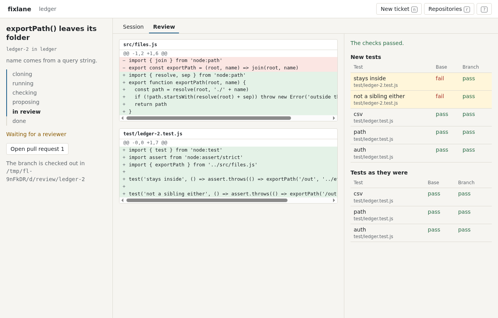

# fixlane

A security team files the same small ticket into hundreds of repositories: bump this package, take that key out, stop building SQL from strings. fixlane is a desktop app where the team hands those tickets to coding agents. A ticket becomes a session, the session a branch, and the branch one small pull request that a person reviews.



On the right is the reason to believe the fix. Both new tests fail on the base commit and pass on the branch. The daemon ran them itself, and whatever the agent said about tests was not read.

## Try it

You need Linux, Docker, Node 24.15 or newer, pnpm 10 and about 2 GB of disk.

```sh
./local
```

That starts Postgres, the sync server, a git host and a package registry with twelve synthetic repositories, the daemon, and the app. Forty tickets are on the board. Press `s` on one to run a recorded session, which needs no key. With `ANTHROPIC_API_KEY` or `OPENAI_API_KEY` set, Claude and Codex can be picked too, and `s` starts the first of them.

Everything works by keyboard, `?` lists the keys. "Take over" freezes the agent and gives you a shell in its container, F6 and Enter hand it back. Closing the window leaves sessions running, since they belong to the daemon.

## Agents get clones

Git worktrees share the stash, the hooks and the config. Two agents in two worktrees can pop each other's stash, and a hook that one of them writes runs in your checkout with your rights. So an agent gets a shared clone in a container without a network, and the branch leaves it as a bundle. Worktrees are for the reviewer. [The ADR](docs/adr/0001-clones-for-agents.md) has the tests that show it and what the clone costs (a tenth of a second).

## What is measured

One machine, four cores. Every row can be run again with the command beside it.

| Check | Target | Measured | |
| --- | --- | --- | --- |
| Crash recovery | 500 runs, no duplicate pull request, no lost session | none, in 500 runs with 1,251 kills at 32 named points and at random moments | `bench/crash.ts 500` |
| Cleanup | nothing left after 200 killed sessions | nothing, 80 of them killed along with the daemon | `bench/cleanup.ts` |
| Isolation and hostile tickets | no token read, no push, no call out, nothing planted gets out | 19 attacks by an agent that does whatever it is told, none of them reached anything | `bench/attacks.ts` |
| Stale lease | 1,000 schedules, no pull request from an old epoch | none wrong, in 3,732 pushes by stale machines and 55 server deaths | `bench/leases.ts` |
| Tests that prove nothing | 20 of 20 turned down | 20 of 20 | `bench/planted.ts` |
| Fixable tickets | at least 24 of 32 | **not measured with a model.** Recorded sessions: 32 of 32, and the 19 code fixes pass a check the agent never saw | `bench/tickets.ts claude` |
| Tickets to stop on | 8 of 8 | **not measured with a model.** Recorded sessions: 8 of 8 | same |
| Sync between two desktops | p95 under 250 ms | 2.9 ms, on one machine | `bench/latency.ts` |
| State machine | 80% of mutants killed | 100%, and 95% for all of `packages/core` | `pnpm test:mutation` |
| Setup | one command | `./local`, 7 seconds once the images are there | |

The two rows in bold matter most, and no model has filled them in. There was no key for it. For the same reason the project's own tickets have not gone through it, which was the plan. What has run are the real SDKs and their tools, in the container, against a scripted model, and recorded sessions with a fix for each ticket. They show that the pipeline works and that the benchmark can be solved. How good an agent is at it is a different question, and so is the cost per merged pull request.

Two things get through the checks for certain: a test that reads the source code, and a fix for only the one input the test uses. `bench/holes.ts` shows both. The rest is in [where-agents-broke.md](docs/where-agents-broke.md).

## Layout

| | |
| --- | --- |
| `packages/core` | state machine, leases, the rules for what counts as fixed. No I/O |
| `packages/gitstore` | mirrors, clones, bundles |
| `packages/sandbox` | the container images, the runner with its three adapters, Docker |
| `packages/hosts` | GitHub and GitLab behind one interface, with one contract suite |
| `packages/daemon` | sessions, checks, proxies, the API for the desktop app |
| `packages/sync` | the server: log, leases, pull requests, webhooks |
| `packages/fakes` | a git host, a registry and models that fail when told to |
| `apps/desktop` | Electron and React |
| `bench` | the forty tickets and everything in the table above |

[docs/design.md](docs/design.md) says how it works and what was left out. [docs/findings.md](docs/findings.md) is a list of what was wrong on the way, and which test found it.

## Running it for real

The daemon reads `~/.config/fixlane.json`:

```json
{
  "github": {
    "url": "https://api.github.com",
    "git": "https://github.com/{project}.git",
    "token": "a token that can push branches"
  },
  "sync": { "url": "http://sync.internal:7700", "token": "yours" }
}
```

```sh
pnpm install && pnpm images && pnpm daemon
pnpm desktop
```

The server takes a file with `database`, `users` and a host with a token that can open pull requests: `pnpm sync server.json`. Desktops don't have that token. Put TLS in front of the server.

Repositories start on "branch only". Anybody can put one back there, and sessions that are already running stop at the branch too.

It has run on one machine, against a git host written for the tests. The nightly job for real GitHub and GitLab accounts exists and has not run yet, and neither has the CI file. Both should run before it is pointed at a repository somebody cares about.

## Tests

```sh
docker compose up -d --wait
pnpm images
pnpm lint && pnpm typecheck && pnpm test
pnpm test:mutation
pnpm --filter @fixlane/desktop build && xvfb-run -a pnpm --filter @fixlane/desktop e2e
```
